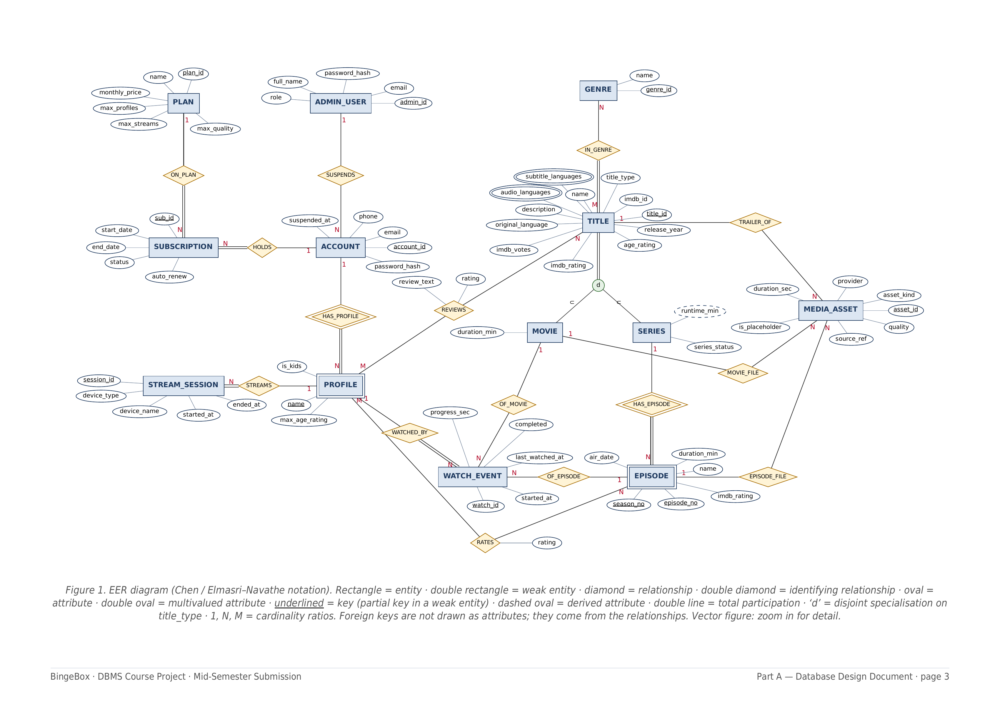

# BingeBox

## A subscription video-streaming platform

DBMS Course Project · Group 7 · Mid-Semester Submission · 11 October 2026

> Conversion note (added): This is a complete content transcription of the six-page [original PDF](BingeBox_MidSem_Submission.pdf). Page boundaries are marked below. Tables have been converted to Markdown, and the landscape EER figure is preserved as an image with an additional text transcription. The verification appendix is editorial material, not part of the original submission. Source claims are preserved even where the appendix identifies qualifications.

<!-- Source page 1 -->

| Name | ID number |
| --- | --- |
| Sai Poojit Baratam | 2024A8PS0494H |
| Girisha | 2024A8PS0497H |
| Puneet Singh | 2024A8PS0507H |
| Vedaang Kharya | 2024A8PS0511H |
| Sanjay Rajkumar | 2024A8PS2044H |

GitHub repository: <https://github.com/Girisha-coder/BingeBox>

## PART A — DATABASE DESIGN DOCUMENT

### 1. Problem, users and plans

BingeBox is a Netflix-style service with **real video playback**. A household account owns one or more viewer **profiles**; its **plan** decides how many profiles it may have, how many devices may stream at once and the best video quality. **Trailers** play from YouTube; **full movies and episodes** play in the browser, and while they play the player reports progress, which drives watch history, resume and "continue watching". Titles without a licensed video play a generated **placeholder** of the same length. The catalogue has genres, IMDb data and user reviews, and is **searchable** by title or description, even with typos. Most rules cut across several relations — plan → subscription → profiles → live streams, profile → watch history → reviews — which makes this a database problem first.

| User | Stored as | Can do | Cannot do |
| --- | --- | --- | --- |
| Guest | Nothing (no login) | Preview only: browse and search the catalogue; see a title card (name, year, genres, audio languages, IMDb rating, short teaser, number of seasons); play trailers; see plans; sign up. | Play full content; see the full description, episode list or reviews. |
| Account holder | ACCOUNT | Log in; subscribe, change plan, switch auto-renew; create, rename and delete profiles; see live devices. | Watch directly — watching happens through a profile. |
| Profile viewer (standard or kids) | PROFILE | Play full content, resume, continue watching, up next; review movies and series; rate episodes. | Kids: anything above 7+, and the account pages. |
| Admin (catalogue, billing, super) | ADMIN_USER | Catalogue: titles, episodes, genres, trailers, videos. Billing: run renewals for a date, suspend accounts. Super: also plans. | See passwords; edit watch history or reviews; extend a subscription by hand. |

| Plan | Profiles (users) | Simultaneous devices | Best quality | Price / month* |
| --- | --- | --- | --- | --- |
| Student | 1 | 1 | HD | ₹99 |
| Basic | 1 | 1 | HD | ₹199 |
| Duo | 2 | 2 | HD | ₹349 |
| Premium | 1 | 3 | 4K | ₹499 |
| Family | 4 | 4 | 4K | ₹649 |

\* Prices and quality are working values; each plan is a row in PLAN, so they change without touching the schema. Student has Basic's limits at a lower price (eligibility checks are out of scope).

### 2. Assumptions

- **A1** One account is one household; the e-mail address is the login and only password hashes are stored. Admins have separate staff logins; guests are not stored.
- **A2 Payments are out of scope for now.** Subscribing activates a plan for one month. A renewal run for a chosen date extends subscriptions with auto-renew on and expires the rest, which stops their streams.
- **A3** A plan change takes effect immediately: the current subscription is cancelled and a new one starts that day.
- **A4** While a full video plays, the browser reports the position every 10–15 s, which saves progress; a title counts as watched at 90 % of its runtime. A device counts as streaming until playback is stopped, or the same device starts a new stream. Dates are stored without a time of day, so ties within one day are ordered by record id.
- **A5** Age ratings U, U/A 7+, 13+, 16+ and A are stored as 0, 7, 13, 16, 18; kids profiles are limited to 7.
- **A6** Trailers are free for everyone, use no device slot and are not stored in watch history.
- **A7** Real full-length videos are used only where legally free (Creative Commons / public domain); every other title gets a placeholder of equal length, in SD so every plan can play it.

*Source footer: BingeBox · DBMS Course Project · Mid-Semester Submission | Part A — Database Design Document · page 1*

<!-- Source page 2 -->

- **A8** Ratings use a 1–10 scale like IMDb; IMDb titles, episodes and ratings are imported reference data.

### 3. Business rules

| # | Rule | Enforced by |
| --- | --- | --- |
| R1 | An account has at most one current subscription. | Partial UNIQUE index |
| R2 | Profiles ≤ the plan's limit; profile names are unique within an account. | Trigger `profile_limit`; UNIQUE |
| R3 | Devices streaming at once ≤ the plan's limit; streaming needs an active subscription and a non-suspended account. | `start_session()` with a row lock |
| R4 | A profile only plays content at or below its age limit; kids ≤ 7. | Trigger `watch_age_check`; CHECK |
| R5 | A watch record is exactly one movie or one episode, and progress never exceeds the runtime. | CHECK; trigger `watch_progress` |
| R6 | Movies and series are reviewed, episodes are rated — only after watching, once per item. | Two triggers; composite PRIMARY KEYs |
| R7 | Every title is exactly one of movie or series; episode numbers are unique within a season. | Composite FOREIGN KEY; UNIQUE |
| R8 | A trailer belongs to a title; a full video to exactly one movie or episode and matches its runtime (± 60 s). | CHECKs; trigger `asset_duration` |
| R9 | At its end date a subscription is renewed (auto-renew on) or expires; expiry stops its streams. | `process_renewals()` |
| R10 | A downgrade is refused while the account has more profiles than the new plan allows. | `change_plan()` |
| R11 | Only billing or super admins suspend accounts; the suspending admin is recorded. | CHECK; `suspend_account()` |
| R12 | Guests see only the preview fields of a title. | View `v_guest_catalog` |
| R13 | Every subscription start and renewal goes through one payment hook (always succeeds until payments exist). | `confirm_payment()` |

### 4. EER model — key decisions

Figure 1 (next page, landscape): 13 entity types (2 weak), 15 relationship types (2 identifying), one specialisation, two multivalued attributes.

- **Specialisation.** TITLE → MOVIE \| SERIES on `title_type`, **disjoint and total**. Shared attributes live once in TITLE, so a review of a movie or a whole series attaches to TITLE (REVIEWS); single episodes are rated through RATES.
- **Weak entities.** PROFILE (owner ACCOUNT, partial key `name`) and EPISODE (owner SERIES, partial key `season_no`, `episode_no`).
- **Entities rather than M:N relationships:** WATCH_EVENT (a profile can watch the same item many times) and MEDIA_ASSET (a title can have a trailer plus files in several qualities).
- **Multivalued attributes.** A title can be played in several audio languages and have subtitles in several languages, so `audio_languages` and `subtitle_languages` are multivalued attributes (double ovals); `original_language` stays single-valued. GENRE, by contrast, is an entity, because genres are shared and browsed on their own.
- **SUBSCRIPTION is its own entity**, not columns of ACCOUNT: it keeps plan history and is where future payments will attach.

*Source footer: BingeBox · DBMS Course Project · Mid-Semester Submission | Part A — Database Design Document · page 2*

<!-- Source page 3 -->

#### Figure 1. EER diagram

*Figure 1. EER diagram (Chen / Elmasri–Navathe notation). Rectangle = entity · double rectangle = weak entity · diamond = relationship · double diamond = identifying relationship · oval = attribute · double oval = multivalued attribute · underlined = key (partial key in a weak entity) · dashed oval = derived attribute · double line = total participation · ‘d’ = disjoint specialisation on title_type · 1, N, M = cardinality ratios. Foreign keys are not drawn as attributes; they come from the relationships. Vector figure: zoom in for detail.*

> Figure transcription (added): The image above preserves the original layout and line notation. The original vector figure remains on page 3 of the PDF; this Markdown embeds a high-resolution raster rendering. The following tables transcribe its labels and connections for searchability.

| Entity type | Attributes drawn in the figure | Key / notation |
| --- | --- | --- |
| PLAN | plan_id, name, monthly_price, max_profiles, max_streams, max_quality | Key: plan_id |
| ADMIN_USER | admin_id, email, password_hash, full_name, role | Key: admin_id |
| ACCOUNT | account_id, email, password_hash, phone, suspended_at | Key: account_id |
| SUBSCRIPTION | sub_id, start_date, end_date, status, auto_renew | Key: sub_id |
| PROFILE | name, is_kids, max_age_rating | Weak entity; partial key: name; owner: ACCOUNT |
| STREAM_SESSION | session_id, device_type, device_name, started_at, ended_at | Key: session_id |
| GENRE | genre_id, name | Key: genre_id |
| TITLE | title_id, imdb_id, name, title_type, description, release_year, age_rating, original_language, imdb_rating, imdb_votes, audio_languages, subtitle_languages | Key: title_id; audio_languages and subtitle_languages are multivalued |
| MOVIE | duration_min | Subclass of TITLE; inherits its key |
| SERIES | series_status, runtime_min | Subclass of TITLE; inherits its key; runtime_min is derived |
| EPISODE | season_no, episode_no, name, duration_min, imdb_rating, air_date | Weak entity; partial key: (season_no, episode_no); owner: SERIES |
| MEDIA_ASSET | asset_id, asset_kind, provider, source_ref, quality, duration_sec, is_placeholder | Key: asset_id |
| WATCH_EVENT | watch_id, started_at, last_watched_at, progress_sec, completed | Key: watch_id |

| Relationship type | Endpoints and cardinality ratio | Additional notation / attributes |
| --- | --- | --- |
| ON_PLAN | PLAN (1) — SUBSCRIPTION (N) | Total participation of SUBSCRIPTION |
| HOLDS | ACCOUNT (1) — SUBSCRIPTION (N) | Total participation of SUBSCRIPTION |
| SUSPENDS | ADMIN_USER (1) — ACCOUNT (N) | Optional suspension |
| HAS_PROFILE | ACCOUNT (1) — PROFILE (N) | Identifying; total participation of PROFILE |
| STREAMS | PROFILE (1) — STREAM_SESSION (N) | Total participation of STREAM_SESSION |
| REVIEWS | PROFILE (M) — TITLE (N) | Attributes: rating, review_text |
| IN_GENRE | TITLE (M) — GENRE (N) | Many-to-many; total participation of TITLE |
| TRAILER_OF | TITLE (1) — MEDIA_ASSET (N) | Trailer ownership |
| MOVIE_FILE | MOVIE (1) — MEDIA_ASSET (N) | Movie file ownership |
| EPISODE_FILE | EPISODE (1) — MEDIA_ASSET (N) | Episode file ownership |
| HAS_EPISODE | SERIES (1) — EPISODE (N) | Identifying; total participation of EPISODE |
| WATCHED_BY | PROFILE (1) — WATCH_EVENT (N) | Total participation of WATCH_EVENT |
| OF_MOVIE | MOVIE (1) — WATCH_EVENT (N) | Movie watch target |
| OF_EPISODE | EPISODE (1) — WATCH_EVENT (N) | Episode watch target |
| RATES | PROFILE (M) — EPISODE (N) | Attribute: rating |

Specialisation: TITLE → MOVIE or SERIES, discriminator `title_type`; the `d` circle denotes disjointness, and the double line from TITLE denotes total specialisation. The figure calls the watch entity `WATCH_EVENT`; the relational schema calls its mapped table `WATCH_HISTORY`.

*Source footer: BingeBox · DBMS Course Project · Mid-Semester Submission | Part A — Database Design Document · page 3*

<!-- Source page 4 -->

### 5. Relational schema and integrity constraints

All 18 relations exactly as created in `db/schema.sql` (read from the database catalogue). **PK** primary key · **PK (part)** part of a composite key · **FK →** foreign key, *(cascade)* = ON DELETE CASCADE · **UQ** unique · **NN** not null · **DEF** default · ranges and sets (≥, 1–10, ∈ {…}) are CHECK constraints · shaded rows are table-level rules.

> Layout note (added): The PDF's two columns are linearised here: left column, then right column, on each page. Shaded table-level rules are bullets immediately below their table.

#### PLAN

| Column | Data type | Constraints |
| --- | --- | --- |
| plan_id | INT | PK, auto-increment |
| name | VARCHAR(30) | UQ, NN |
| monthly_price | DECIMAL(8,2) | NN, ≥ 0 |
| max_profiles | SMALLINT | NN, 1–10 |
| max_streams | SMALLINT | NN, 1–10 |
| max_quality | VARCHAR(3) | NN, ∈ {SD, HD, 4K} |

#### ADMIN_USER

| Column | Data type | Constraints |
| --- | --- | --- |
| admin_id | INT | PK, auto-increment |
| email | VARCHAR(255) | UQ, NN, e-mail format |
| password_hash | VARCHAR(255) | NN |
| full_name | VARCHAR(80) | NN |
| role | VARCHAR(10) | NN, ∈ {catalogue, billing, super} |
| created_at | DATE | NN, DEF today |

#### ACCOUNT

| Column | Data type | Constraints |
| --- | --- | --- |
| account_id | INT | PK, auto-increment |
| email | VARCHAR(255) | UQ, NN, e-mail format |
| password_hash | VARCHAR(255) | NN |
| phone | VARCHAR(15) | UQ |
| created_at | DATE | NN, DEF today |
| suspended_at | DATE | NULL allowed |
| suspended_by_admin | INT | FK → admin_user |

- CHECK suspended_at, suspended_by_admin both set or both null

#### SUBSCRIPTION

| Column | Data type | Constraints |
| --- | --- | --- |
| sub_id | INT | PK, auto-increment |
| account_id | INT | FK → account (cascade), NN |
| plan_id | INT | FK → plan, NN |
| start_date | DATE | NN |
| end_date | DATE | NN |
| status | VARCHAR(10) | NN, DEF 'active', ∈ {active, past_due, expired, cancelled} |
| auto_renew | BOOLEAN | NN, DEF true |

- CHECK end_date ≥ start_date
- partial UQ (account_id) for active / past_due: one current subscription

#### PROFILE

| Column | Data type | Constraints |
| --- | --- | --- |
| profile_id | INT | PK, auto-increment |
| account_id | INT | FK → account (cascade), NN |
| name | VARCHAR(30) | NN |
| is_kids | BOOLEAN | NN, DEF false |
| max_age_rating | SMALLINT | NN, DEF 18, ∈ {0, 7, 13, 16, 18} |
| created_at | DATE | NN, DEF today |

- UQ (account_id, name)
- CHECK is_kids ⇒ max_age_rating ≤ 7
- trigger profile_limit: profiles ≤ plan limit

#### STREAM_SESSION

| Column | Data type | Constraints |
| --- | --- | --- |
| session_id | INT | PK, auto-increment |
| profile_id | INT | FK → profile (cascade), NN |
| device_type | VARCHAR(10) | NN, ∈ {tv, mobile, tablet, web} |
| device_name | VARCHAR(50) | NN |
| started_at | DATE | NN, DEF today |
| ended_at | DATE | NULL allowed |

- CHECK ended_at ≥ started_at
- live streams ≤ plan limit (start_session)

#### TITLE

| Column | Data type | Constraints |
| --- | --- | --- |
| title_id | INT | PK, auto-increment |
| imdb_id | VARCHAR(12) | UQ |
| name | VARCHAR(200) | NN |
| release_year | SMALLINT | NN, 1888–2100 |
| description | VARCHAR(2000) | NULL allowed |
| age_rating | SMALLINT | NN, ∈ {0, 7, 13, 16, 18} |
| original_language | VARCHAR(30) | NN, DEF 'English' |
| imdb_rating | DECIMAL(3,1) | 0–10 |
| imdb_votes | INT | ≥ 0 |
| title_type | VARCHAR(1) | NN, ∈ {M, S} |

- UQ (title_id, title_type)
- GIN full-text index on name + description

#### MOVIE

| Column | Data type | Constraints |
| --- | --- | --- |
| title_id | INT | PK |
| title_type | VARCHAR(1) | NN, DEF 'M', = 'M' |
| duration_min | SMALLINT | NN, 1–600 |

- FK (title_id, title_type) → title

#### SERIES

| Column | Data type | Constraints |
| --- | --- | --- |
| title_id | INT | PK |
| title_type | VARCHAR(1) | NN, DEF 'S', = 'S' |
| series_status | VARCHAR(10) | NN, ∈ {ongoing, ended} |

- FK (title_id, title_type) → title

#### EPISODE

| Column | Data type | Constraints |
| --- | --- | --- |
| episode_id | INT | PK, auto-increment |
| series_id | INT | FK → series (cascade), NN |
| season_no | SMALLINT | NN, ≥ 1 |
| episode_no | SMALLINT | NN, ≥ 1 |
| name | VARCHAR(200) | NN |
| duration_min | SMALLINT | NN, 1–300 |
| imdb_rating | DECIMAL(3,1) | 0–10 |
| air_date | DATE | NULL allowed |

- UQ (series_id, season_no, episode_no)

#### GENRE

| Column | Data type | Constraints |
| --- | --- | --- |
| genre_id | SMALLINT | PK, auto-increment |
| name | VARCHAR(30) | UQ, NN |

*Source footer: BingeBox · DBMS Course Project · Mid-Semester Submission | Part A — Database Design Document · page 4*

<!-- Source page 5 -->

#### TITLE_GENRE

| Column | Data type | Constraints |
| --- | --- | --- |
| title_id | INT | PK (part), FK → title (cascade) |
| genre_id | SMALLINT | PK (part), FK → genre |

#### TITLE_AUDIO

| Column | Data type | Constraints |
| --- | --- | --- |
| title_id | INT | PK (part), FK → title (cascade) |
| language | VARCHAR(30) | PK (part), not blank |

- multivalued attribute audio_languages of TITLE

#### TITLE_SUBTITLE

| Column | Data type | Constraints |
| --- | --- | --- |
| title_id | INT | PK (part), FK → title (cascade) |
| language | VARCHAR(30) | PK (part), not blank |

- multivalued attribute subtitle_languages of TITLE

#### MEDIA_ASSET

| Column | Data type | Constraints |
| --- | --- | --- |
| asset_id | INT | PK, auto-increment |
| asset_kind | VARCHAR(7) | NN, ∈ {trailer, full} |
| title_id | INT | FK → title (cascade) |
| movie_id | INT | FK → movie (cascade) |
| episode_id | INT | FK → episode (cascade) |
| provider | VARCHAR(7) | NN, ∈ {youtube, file} |
| source_ref | VARCHAR(500) | NN |
| quality | VARCHAR(3) | NN, DEF 'HD', ∈ {SD, HD, 4K} |
| duration_sec | INT | NN, > 0 |
| is_placeholder | BOOLEAN | NN, DEF false |
| created_at | DATE | NN, DEF today |

- UQ nulls not distinct (asset_kind, title_id, movie_id, episode_id, quality)
- CHECK trailer ⇒ title_id only; full ⇒ exactly one of movie_id, episode_id
- CHECK trailer ≤ 900 s; placeholder ⇒ full file
- trigger asset_duration: length = runtime ± 60 s

#### WATCH_HISTORY

| Column | Data type | Constraints |
| --- | --- | --- |
| watch_id | INT | PK, auto-increment |
| profile_id | INT | FK → profile (cascade), NN |
| movie_id | INT | FK → movie (cascade) |
| episode_id | INT | FK → episode (cascade) |
| started_at | DATE | NN, DEF today |
| last_watched_at | DATE | NN, DEF today |
| progress_sec | INT | NN, DEF 0, ≥ 0 |
| completed | BOOLEAN | NN, DEF false |

- CHECK exactly one of movie_id, episode_id
- triggers watch_age_check, watch_progress

#### TITLE_REVIEW

| Column | Data type | Constraints |
| --- | --- | --- |
| profile_id | INT | PK (part), FK → profile (cascade) |
| title_id | INT | PK (part), FK → title (cascade) |
| rating | SMALLINT | NN, 1–10 |
| review_text | VARCHAR(2000) | NULL allowed |
| created_at | DATE | NN, DEF today |
| updated_at | DATE | NN, DEF today |

- trigger review_requires_watch

#### EPISODE_RATING

| Column | Data type | Constraints |
| --- | --- | --- |
| profile_id | INT | PK (part), FK → profile (cascade) |
| episode_id | INT | PK (part), FK → episode (cascade) |
| rating | SMALLINT | NN, 1–10 |
| rated_at | DATE | NN, DEF today |

- trigger eprating_requires_watch

### 6. Normalisation and design

All attributes are atomic (genres, languages and episodes are rows, not lists), so every relation is in 1NF. In each relation every non-trivial functional dependency has a candidate key on its left — e.g. account_id → all, email → account_id; (series_id, season_no, episode_no) → episode_id; (account_id, name) → profile_id — so the schema is in **BCNF**.

- **Redundancy designed out:** STREAM_SESSION has no account_id (session_id → profile_id → account_id would be transitive); SUBSCRIPTION stores no price or limits (they depend only on plan_id); average ratings and series runtimes are computed in views.
- **No stored derived data:** full-text search uses a GIN index built on an expression over name and description, so no extra column has to be kept in sync.
- **Data types** are limited to INT, SMALLINT, DECIMAL, VARCHAR, BOOLEAN and DATE; keys are INT identity columns (auto-increment).
- **Mapping:** 1:N → foreign key on the N side (NN when participation is total); M:N → own relation keyed by both sides; multivalued attribute → own relation keyed by (owner key, value), e.g. TITLE_AUDIO(title_id, language); specialisation → TITLE plus one relation per subclass, with (title_id, title_type) foreign keys enforcing disjointness; weak entities → surrogate key plus UQ(owner, partial key).
- **Ready for payments:** SUBSCRIPTION is separate from ACCOUNT and every start or renewal calls `confirm_payment()`, so payments later only add relations.

*Source footer: BingeBox · DBMS Course Project · Mid-Semester Submission | Part A — Database Design Document · page 5*

<!-- Source page 6 -->

## PART B — APPLICATION DESIGN

### 7. Technology stack and architecture

Three tiers — **React front end ↔ FastAPI back end ↔ PostgreSQL** — packaged with Docker Compose so the whole system starts with one command.

| Tier | Choice | Role in the system |
| --- | --- | --- |
| Front end | React (Vite) + React Router | Guest pages (browse, search, title preview, plans); Who's watching; Home rows; Player; Account; Admin console. |
| Back end | Python FastAPI + psycopg 3 | Logins for accounts and admins with role checks; hand-written parameterised SQL (no ORM); each workflow calls a database function inside a transaction; database errors become clear messages. |
| Database | PostgreSQL 16 | 18 relations, 6 triggers, 15 functions, 4 views, 12 indexes; pg_trgm for fuzzy search. |
| Video | YouTube IFrame API + HTML5 video | Trailers from YouTube; full videos or placeholders played in the browser, which sends progress reports to the back end. |
| Data loading | Python scripts | IMDb datasets for titles, episodes and ratings; synthetic accounts and activity written through the database functions. |

### 8. End-to-end workflows

| Workflow | Steps (front end → API → database) | DBMS concepts shown |
| --- | --- | --- |
| W1 Subscription lifecycle (coordinated change across relations) | Choose a plan → `subscribe()`. Change plan → `change_plan()` (refused if too many profiles). Admin runs renewals for a date → `process_renewals()` renews or expires each ended subscription and closes that account's live streams. Admin suspends an account → its streams stop. | Transactions, stored functions, row locks, partial unique index, CHECKs |
| W2 Discover and search (complex retrieval and reporting) | Guests and profiles search (full-text, typo-tolerant) and browse by genre, audio or subtitle language, runtime and rating; guests get the preview view only. Home rows: continue watching, up next, top 10 per genre, because-you-watched. Title page with trailer, episodes and ratings. | Views, CTEs, window functions, LATERAL joins, GIN and trigram indexes |
| W3 Playback under plan limits (integrity and constraint enforcement) | Trailer plays at once. Full content: `start_playback()` checks age limit, subscription, suspension and a free device slot, picks the best file the plan allows and resumes or creates the history row; progress reports → `record_progress()`; stop → `end_playback()`. Demo: 2nd device on a Basic plan, 18+ title on a kids profile, 3rd profile on a Duo plan. | Triggers, CHECK and UNIQUE, row locking; the database's error shown in the UI |

**Supporting create / update / delete:** sign-up and login; profiles; reviews and ratings; auto-renew switch; admin management of titles, episodes, genres, trailers and videos; plans; suspension and reinstatement. **Planned queries** (`db/queries.sql`): browse/filter, up next, top 10 per genre, recommendations, search, active subscriptions per plan, lapsing subscriptions, binge report, rating comparison.

#### Database objects behind the workflows

| Kind | Objects |
| --- | --- |
| Functions (15) | Subscriptions: `subscribe`, `change_plan`, `process_renewals`, `confirm_payment`. Playback: `start_session`, `start_playback`, `record_progress`, `end_playback`. Admin: `suspend_account`, `reinstate_account`. Helpers: `current_plan`, `item_age_rating`, `item_runtime_sec`, `quality_rank`, `require_admin_role`. |
| Views (4) | `v_title_catalog` (runtime, genres, ratings, trailer flag); `v_guest_catalog` (guest preview); `v_account_status`; `v_continue_watching` (window function). |
| Indexes (12) | GIN full-text on title; trigram on title name; audio and subtitle language lookups; watch history by profile and recency; partial indexes on live sessions and subscriptions due; review, rating and genre lookups. |
| Transactions | Subscribe, plan change, renewals and start playback each run as one transaction and lock the ACCOUNT row, so two devices pressing play together cannot both pass the limit. |

*Source footer: BingeBox · DBMS Course Project · Mid-Semester Submission | Part B — Application Design · page 6*

---

## Verification appendix (added; not in the PDF)

Verified on 20 October 2026 against the local six-page PDF. Verification covers transcription fidelity and the document's internal consistency. The repository, SQL implementation and running application were not audited. In particular, the PDF's statement that its schema was read from the database catalogue is reproduced as a source claim, not independently confirmed.

### Coverage

| Source page | Content retained | Verification |
| --- | --- | --- |
| 1 | Title, subtitle, group/date, all 5 names and IDs, repository link, Part A, section 1, 4 user roles, 5 plans and price note, section 2 and A1–A7, footer | Text extraction and visual inspection |
| 2 | A8, all 13 business rules with enforcement mechanisms, section 4 and all 5 design decisions, footer | Text extraction and visual inspection |
| 3 | Original EER figure, full caption and legend, footer; added searchable transcription | Visual inspection; 13 entity types, 15 relationships, 2 weak entities, 2 identifying relationships, 2 multivalued attributes and 1 specialisation checked |
| 4 | Section 5 introduction and legend; PLAN through GENRE, including all column types, constraints and table-level rules; footer | Both columns checked against the rendered page |
| 5 | TITLE_GENRE through EPISODE_RATING, including all column types and rules; complete section 6; footer | Both columns checked against the rendered page |
| 6 | Part B, sections 7–8, all 5 technology rows, W1–W3, supporting CRUD and 9 planned query categories, database object inventory, transaction statement, footer | Text extraction and visual inspection |

The schema contains 18 relations and 99 column definitions. All six named triggers, 15 named functions and four named views are retained. The PDF states that there are 12 indexes, but lists categories rather than 12 individual names; this conversion preserves that distinction.

An automated comparison found no differences in the ordered words, identifiers, numbers and mathematical comparison symbols on the five text pages after removing Markdown formatting and added notes. All 99 schema rows were also checked individually against the extracted source, and every diagram label is represented in the figure transcription. The original title block, caption, page footers and diagram notation were checked visually. Both Markdown files parse successfully, and all local file/image links resolve. These checks establish content fidelity; they do not establish that the proposed software works.

### Source qualifications and implementation questions

These are observations about the source, not silent edits to its contents. Resolve them when implementing and revising the final report.

1. **Total specialisation needs additional enforcement.** R7 promises that every TITLE has exactly one subtype. The displayed composite foreign keys and fixed subtype discriminators prevent an inconsistent subtype and enforce disjointness, but do not by themselves require a TITLE row to have a MOVIE or SERIES row. This is an inference from the displayed schema and the direction of [PostgreSQL 16 foreign-key checks](https://www.postgresql.org/docs/16/tutorial-fk.html). Verify an atomic creation path and, if database-wide enforcement is required, a deferred constraint mechanism.
2. **Renewal wording is ambiguous.** A2 and R9 say that expiry stops streams. W1 can be read as closing streams for both renewed and expired subscriptions. Decide whether successfully renewed subscriptions keep their streams; the companion workflow recommends that they do.
3. **WATCH_EVENT and WATCH_HISTORY are different names for the conceptual and relational versions of the watch record.** Both original names are retained. State this mapping explicitly in implementation documentation.
4. **The BCNF claim needs a relation-by-relation argument.** The examples in section 6 are useful but do not constitute a proof for all 18 relations. In particular, explain the treatment of the fixed `title_type` columns in MOVIE/SERIES and conditional dependencies associated with nullable media targets. Do not infer formal BCNF solely from the absence of obvious duplicate fields.
5. **Two broad statements in section 6 need qualification.** GENRE uses a SMALLINT key, so not all keys are INT; several relations also have composite or inherited keys rather than new identity keys. `WATCH_HISTORY.completed` is stored even though A4 defines completion from progress and runtime, so “No stored derived data” is too broad; its specific full-text-search example can still be valid.
6. **Device identity and stale sessions are underspecified.** The schema exposes `device_type` and `device_name`, but no stable device identifier or heartbeat timestamp. A4's “same device starts a new stream” needs a documented identity rule. DATE fields cannot support a precise idle timeout; do not claim such a timeout without changing the design.
7. **Several business choices remain open.** Define series-review eligibility, replay versus resume, calendar-month boundaries, missed renewal runs, plan changes when existing streams exceed the new stream/quality limit, and admin edits to plans already in use. The six-page submission does not fully specify these cases.
8. **Counts are document counts, not deployment evidence.** The named objects can be counted here, but SQL correctness, actual trigger firing, index definitions, role permissions and race-condition handling require implementation inspection and execution tests. A CHECK storing suspension metadata does not itself verify the caller's admin role.

The separate [project workflow](BingeBox_Project_Workflow.md) turns the submission into a sequenced implementation and verification plan, with recommendations clearly distinguished from original requirements.
